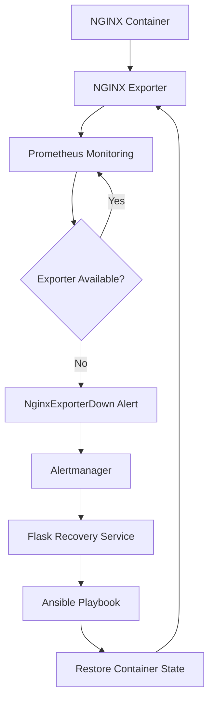
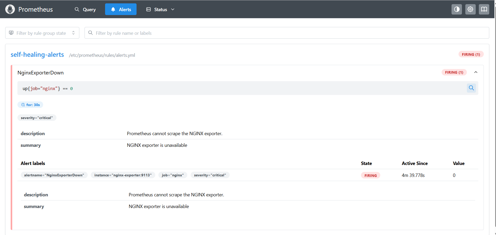
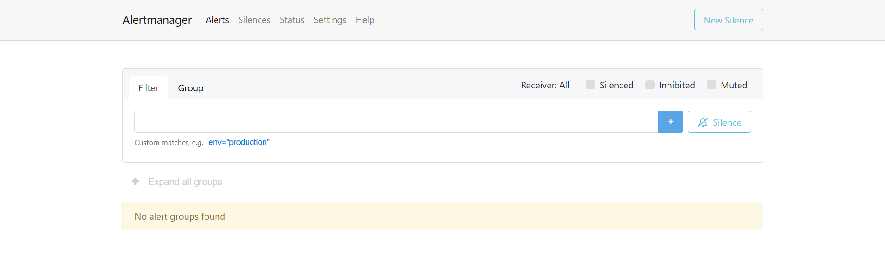
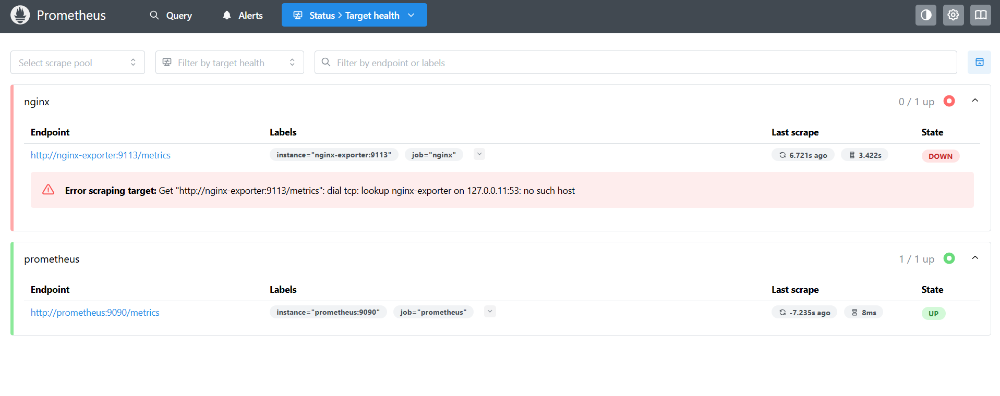
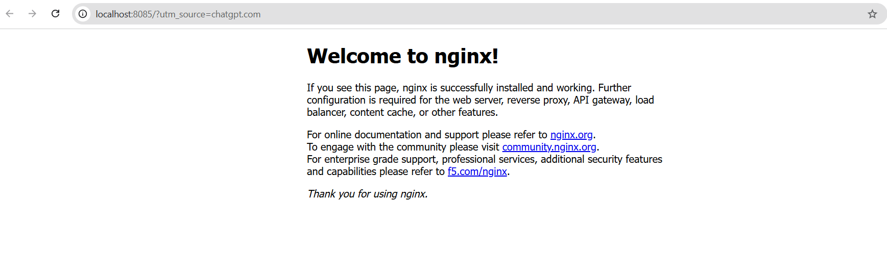
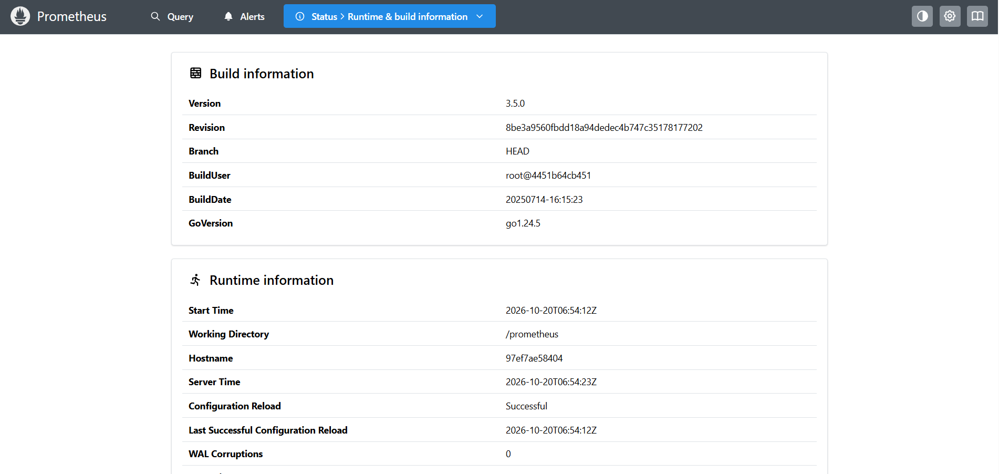
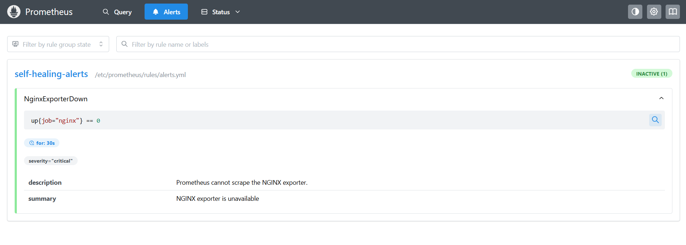
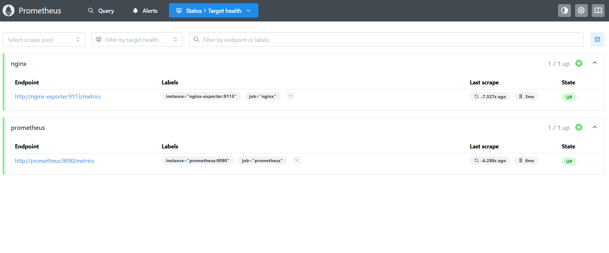

# 🛡️ Self-Healing Infrastructure


### Automated Monitoring • Alerting • Recovery

A containerized DevOps project that detects service failures, raises alerts, and automatically attempts recovery using **Prometheus, Alertmanager, Docker, Flask, and Ansible**.

<p align="center">
  
  
  
  
  
</p>

---

## 📌 Overview

This project demonstrates a **self-healing workflow for containerized infrastructure**. Prometheus monitors an NGINX exporter, Alertmanager routes failure alerts, and a Flask recovery service executes an Ansible playbook to restore the expected container state.

The objective is to reduce manual intervention and demonstrate automated failure detection, alert handling, and service recovery.

## 🏗️ Architecture



## ⚙️ Technology Stack

| Technology | Purpose |
|---|---|
| Docker Compose | Runs and connects project services |
| NGINX | Web server |
| NGINX Exporter | Exposes metrics for monitoring |
| Prometheus | Scrapes metrics and evaluates alert rules |
| Alertmanager | Routes alerts to the recovery webhook |
| Python + Flask | Receives webhook requests |
| Ansible | Automates container recovery |
| Git + GitHub | Version control and project hosting |
| WSL + Ubuntu | Development environment |

## 🔄 How It Works

1. **Monitor:** Prometheus scrapes metrics from the NGINX exporter.
2. **Detect:** Prometheus evaluates the `NginxExporterDown` alert rule.
3. **Alert:** If the exporter remains unavailable for 30 seconds, the alert fires.
4. **Route:** Alertmanager sends a webhook to the Flask recovery service.
5. **Recover:** Flask invokes the Ansible playbook.
6. **Restore:** Ansible ensures the NGINX and exporter containers are running.
7. **Verify:** Prometheus detects the recovered exporter and resolves the alert.

## 🚨 Alert Configuration

The project uses this Prometheus expression:

```promql
up{job="nginx"} == 0
```

Configured waiting period:

```yaml
for: 30s
```

This prevents a brief scrape failure from immediately triggering recovery.

## ✅ End-to-End Test Results

The workflow was tested by stopping the NGINX exporter.

| Validation | Observed result |
|---|---|
| Exporter stopped | Confirmed |
| Prometheus query | `up{job="nginx"} = 0` |
| Alert state | `Pending` → `Firing` |
| Alertmanager webhook | Received by recovery service |
| Ansible return code | `0` |
| Ansible playbook failures | `0` |
| Exporter after recovery | `Up` |
| Prometheus alert after recovery | `Inactive` |

**Outcome:** The tested failure-detection and recovery workflow completed successfully.

## 🚀 Getting Started

### Prerequisites

- Docker Desktop with Docker Compose
- WSL 2 with Ubuntu (if using Windows)
- Git

### Start the project

Clone the repository:

```bash
git clone https://github.com/Annapurna1912/Self-healing-infrastructure.git
cd Self-healing-infrastructure
```

Build and start the services:

```bash
docker compose up -d --build
```

Check service status:

```bash
docker compose ps
```

View recovery logs:

```bash
docker logs --tail 50 self-healing-recovery
```

Stop services without deleting containers:

```bash
docker compose stop
```

## 🌐 Local Endpoints

| Service | URL |
|---|---|
| NGINX website | [http://localhost:8085](http://localhost:8085) |
| Prometheus | [http://localhost:9090](http://localhost:9090) |
| Alertmanager | [http://localhost:9093](http://localhost:9093) |
| Recovery API | [http://localhost:5000](http://localhost:5000) |

## 📁 Project Structure

```text
self-healing-infrastructure/
├── alertmanager/
│   └── alertmanager.yml
├── ansible/
│   └── recover-nginx.yml
├── nginx/
│   └── default.conf
├── prometheus/
│   ├── prometheus.yml
│   └── rules/
│       └── alerts.yml
├── recovery/
│   ├── app.py
│   └── Dockerfile
├── compose.yaml
└── README.md
```

## 🧠 Skills Demonstrated

- Infrastructure monitoring and metric-based alerting
- Docker container management and Compose networking
- Alert routing with Alertmanager
- Webhook automation using Python and Flask
- Infrastructure recovery with Ansible
- Troubleshooting, log analysis, and end-to-end validation
- Linux, WSL, and Git-based version control

## 🔮 Future Enhancements

- Add Grafana dashboards for infrastructure visibility.
- Integrate email or messaging notifications.
- Add CI/CD automation for testing and deployment.
- Improve API security, logging, and recovery error handling.
- Add repeatable automated tests for recovery scenarios.


### 🔄 Recovery Workflow

**Monitor → Detect → Alert → Webhook → Ansible Recovery → Verify**

Prometheus detects the exporter failure, Alertmanager forwards the alert, and the Flask recovery service executes Ansible to restore the expected container state.


---

## 📸 Project Screenshots

### 1. Prometheus Alert Firing


### 2. Alertmanager


### 3. Failure Detection


### 4. NGINX Web Server


### 5. Prometheus Runtime Information


### 6. Alert Cleared After Recovery


### 7. Healthy Monitoring Targets
